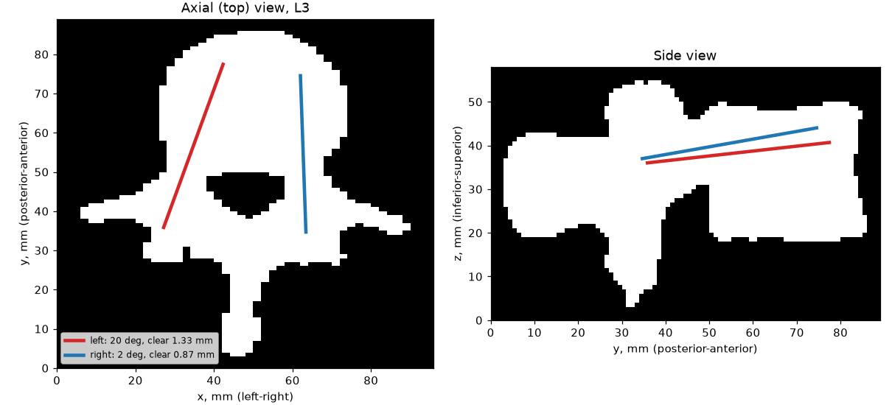

# SpineSight

A low-cost trainer for pedicle screw placement: a 3D-printed vertebra made from a real CT scan, a webcam, and a model that scores the student's trajectory and refuses to score when it is not sure.

This repository is at step 1: CT segmentation → printable vertebra (STL) → planned screw trajectories.



## What `spine.py` does

1. Loads a VerSe vertebra mask (NIfTI) and keeps one vertebra (default: label 22 = L3).
2. Builds a smooth surface (Gaussian blur + marching cubes) and saves it as STL, in millimetres.
3. Finds the spinal canal and, on each side, the narrowest slice of the pedicle (the isthmus).
4. Tries screw directions through the isthmus (medial −10…44°, cranial −14…14°, step 2°) and keeps the one with the largest distance to the bone surface that still reaches the middle of the vertebral body.
5. Reports entry point, tip, length, angles, pedicle size, clearance and breach (clearance < 0 means the 6.5 mm screw would leave the bone).

## Run

```
pip install -r requirements.txt
python spine.py data/sub-verse031_seg-vert_msk.nii.gz outputs 22
python -m pytest -q
```

Input data (not in the repo): VerSe 2019, case `sub-verse031`, from https://osf.io/jtfa5/
- mask: https://osf.io/download/92efg/ → `data/sub-verse031_seg-vert_msk.nii.gz`
- CT: https://osf.io/download/wxc4t/ → `data/sub-verse031_ct.nii.gz`

## Outputs

| File | What |
|---|---|
| `outputs/vertebra.stl` | L3, ready to print (mm) |
| `outputs/vertebra_with_screws.stl` | L3 with the two planned screws, for viewing |
| `outputs/plan.json` | sizes for caliper check, trajectories, clearance |
| `outputs/preview.png` | top and side view |

## Current result (L3, sub-verse031)

| | Left | Right |
|---|---|---|
| Medial angle | 20° | 2° |
| Cranial angle | 6° | 10° |
| Screw length | 44.5 mm | 40.5 mm |
| Clearance (6.5 mm screw) | 1.33 mm | 0.87 mm |

Vertebral body: 48 × 36 × 32 mm (width × depth × height).

## Camera rig and ground truth (`rig/`)

Ground truth for the real test set: a ChArUco board and the printed vertebra glued to one rigid plate, side by side. The board gives the camera pose; a one-time registration gives the vertebra pose on the board.

Run from the `rig` folder:

```
python make_board.py
python calibrate.py
python register.py
python capture.py
python -m pytest -q
```

1. `make_board.py` writes `board.pdf` (A4, 7×5 squares of 30 mm). Print at 100% and measure a square; if it is not 30 mm, set `SQUARE_MM` in `common.py`.
2. `calibrate.py` — show the board from 15–30 angles, press space for each view, q to finish. Saves `camera.json`. Good result: below 0.5 px.
3. `register.py` — writes `landmarks.png` with 4 points (spinous tip, left and right transverse tips, front of the body). Take 3+ views (space), then click each point in each view (enter = ok, s = not visible). Rays from all views are triangulated in board coordinates and matched to the STL points (Kabsch). Saves `vertebra_pose.json` with the error per point in mm.
4. `capture.py` — live view with the STL outline drawn on the vertebra. Space saves the frame and its pose to `test_real/`. Collect 300–500 frames (light, background, distance, occlusion) and do not change them later.

## Synthetic training data (`synth/`)

```
cd synth
python generate.py 10000
python -m pytest -q
```

- 10 keypoints are picked on the STL surface by farthest point sampling (`synth_out/keypoints.json`).
- Each image: random rotation, distance 250–600 mm, a simple numpy/OpenCV renderer (painter's algorithm, diffuse + specular light), random background, 0–2 occluders, blur, noise, brightness and JPEG quality.
- Each label (`NNNNNN.json`) has the same pose format as `rig/capture.py` plus `keypoints_2d` and `visible` (hidden by the vertebra itself or by an occluder).
- Uses `rig/camera.json` when it exists, at half resolution.
- Put your own background photos (jpg/png) into `synth/backgrounds/`; without them only generated backgrounds are used.
- `synth_out/preview.jpg` shows 16 samples (green = visible keypoint, red = hidden); `preview_real.jpg` shows 16 real frames when `test_real/` exists.

## Pose model (`model/`)

Keypoint heatmaps + PnP, following "Simple Baselines for Human Pose Estimation" (Xiao et al., 2018): ResNet-18 (ImageNet weights) → 3 transposed convolutions → one heatmap per keypoint at 1/4 resolution. Input 640×352. Keypoints are read as the weighted mean around the heatmap peak, then `solvePnPRansac` (EPnP) + Levenberg–Marquardt refinement gives the vertebra pose.

```
cd model
python train.py ../synth_out 30
python evaluate.py model.pt ../synth_out
python evaluate.py model.pt ../test_real
python -m pytest -q
```

- `train.py` keeps the last 5% of synthetic images for validation and saves the best `model.pt`.
- `evaluate.py` on `synth_out` uses only those validation images; on `test_real` it uses every frame. It prints median and 90th percentile of: rotation error, translation error, ADD (mean distance of model points), screw entry point error and screw direction error for both planned screws, keypoint error in pixels, and the share of frames with ADD below 10% of the vertebra size. Per-frame numbers go to `results.csv`.

### Training on Google Colab (free GPU)

```
!git clone https://github.com/mynameisaltynbek/spinesight
%cd spinesight
!pip install -q -r requirements.txt
!python synth/generate.py 10000
%cd model
!python train.py ../synth_out 30
```

Upload your `synth/backgrounds/` photos before `generate.py`, and download `model/model.pt` when training ends.

## Known limits

- The mask has 2 mm voxels left-right, so pedicle width is measured in 2 mm steps.
- The planner maximises clearance only; it does not follow surgical rules for the entry point yet, so left and right angles can differ.
- Trajectories are not validated by a surgeon.

## Licenses

- Code: MIT (`LICENSE`).
- Everything in `outputs/` is derived from VerSe and is CC BY-SA 4.0 (`outputs/LICENSE.md`).

VerSe: Sekuboyina A et al., Medical Image Analysis 2021; Löffler M et al., Radiology: AI 2020; Liebl H, Schinz D et al., 2021.
